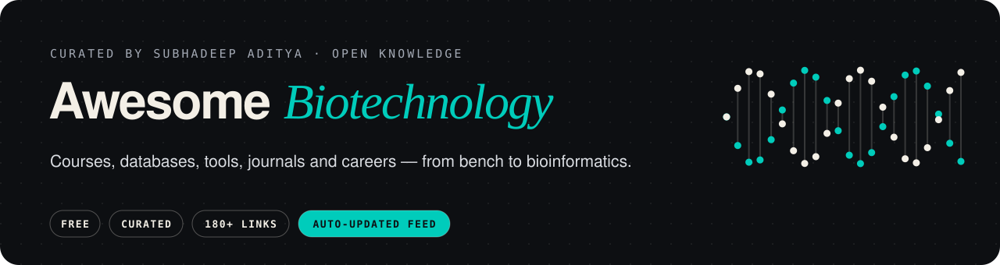
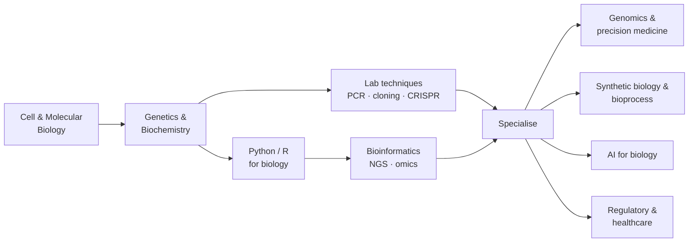

  
  
  
  
  

<b>A hand-picked map of the best free resources for learning, researching and building a career in biotechnology.</b> 
Every link is chosen for quality, not quantity. ⭐ Star the repo to keep it handy — it is updated regularly.

> **New this week →** [`LATEST.md`](LATEST.md) is refreshed automatically every Monday with the newest bioRxiv preprints in genomics, synthetic biology, bioinformatics and immunology.

---

## Contents

- [Start here — a learning path](#-start-here--a-learning-path)
- [Courses and lectures](#-courses-and-lectures)
- [Free textbooks and references](#-free-textbooks-and-references)
- [Databases](#-databases)
- [Bioinformatics tools](#-bioinformatics-tools)
- [Programming for biologists](#-programming-for-biologists)
- [Lab protocols and wet-lab skills](#-lab-protocols-and-wet-lab-skills)
- [Molecular visualisation and design](#-molecular-visualisation-and-design)
- [AI in biology](#-ai-in-biology)
- [Journals, preprints and staying current](#-journals-preprints-and-staying-current)
- [Podcasts, newsletters and YouTube](#-podcasts-newsletters-and-youtube)
- [Regulation, IP and bioethics](#-regulation-ip-and-bioethics)
- [Careers, exams and fellowships (India + global)](#-careers-exams-and-fellowships-india--global)
- [Communities](#-communities)
- [Related lists](#-related-lists)

---

## 🧭 Start here — a learning path

| Stage | Do this | Free resource |
|:--|:--|:--|
| 1 · Foundations | Cell, molecular biology, genetics | [MIT 7.016 Introductory Biology](https://ocw.mit.edu/courses/7-016-introductory-biology-fall-2018/) · [Open Biology Handbook](https://github.com/Subhadeep998/Open-Biology-Handbook) |
| 2 · Biochemistry | Proteins, enzymes, metabolism | [LibreTexts Biochemistry](https://bio.libretexts.org/Bookshelves/Biochemistry) |
| 3 · Code | Python or R basics | [Rosalind](https://rosalind.info) · [Biostar Handbook](https://www.biostarhandbook.com) |
| 4 · Omics | NGS, RNA-seq, variant calling | [Galaxy Training Network](https://training.galaxyproject.org) |
| 5 · Specialise | Pick a track below and build a project | [EMBL-EBI Training](https://www.ebi.ac.uk/training/) |

---

## 🎓 Courses and lectures

**Foundations**
- [MIT OpenCourseWare — Biology](https://ocw.mit.edu/search/?d=Biology) — full lecture sets for intro biology, genetics, biochemistry and cell biology.
- [Khan Academy — Biology](https://www.khanacademy.org/science/biology) — short, clear explainers; great for revision.
- [iBiology](https://www.ibiology.org) — free talks by leading scientists, from Nobel laureates to early-career researchers.
- [HHMI BioInteractive](https://www.biointeractive.org) — animations, virtual labs and case studies.
- [NPTEL — Biotechnology](https://nptel.ac.in/course.html) — IIT/IISc courses with optional certification exams (India).
- [SWAYAM](https://swayam.gov.in) — UGC/AICTE-approved MOOCs, many credit-transferable in Indian universities.

**Bioinformatics and genomics**
- [Galaxy Training Network](https://training.galaxyproject.org) — hands-on tutorials for NGS, proteomics and more, no installation needed.
- [EMBL-EBI Training](https://www.ebi.ac.uk/training/) — free on-demand courses on every major EBI database and method.
- [Coursera — Genomic Data Science (Johns Hopkins)](https://www.coursera.org/specializations/genomic-data-science) — audit for free.
- [Coursera — Bioinformatics (UC San Diego)](https://www.coursera.org/specializations/bioinformatics) — companion to *Bioinformatics Algorithms*.
- [Sanger Institute — Learning & Training](https://www.wellcomeconnectingscience.org/) — courses and conferences via Wellcome Connecting Science.
- [Harvard Chan Bioinformatics Core training](https://hbctraining.github.io/main/) — RNA-seq, ChIP-seq, single-cell; superb lesson notes.
- [Data Carpentry — Genomics](https://datacarpentry.org/lessons/#genomics-workshop) — the gentlest on-ramp to the command line for biologists.

**Specialised**
- [iGEM Technology resources](https://technology.igem.org/) — synthetic-biology engineering and parts guides.
- [edX — Principles of Biochemistry (Harvard)](https://www.edx.org/learn/biochemistry/harvard-university-principles-of-biochemistry)
- [Broad Institute — Primers & online learning](https://www.broadinstitute.org/education)
- [Cold Spring Harbor — DNA Learning Center](https://dnalc.cshl.edu) — interactive 3D animations and DNA-subway workflows.

---

## 📚 Free textbooks and references

- [OpenStax Biology 2e](https://openstax.org/details/books/biology-2e) — peer-reviewed, free, college-level.
- [OpenStax Microbiology](https://openstax.org/details/books/microbiology)
- [NCBI Bookshelf](https://www.ncbi.nlm.nih.gov/books/) — free full-text editions of classics such as *Molecular Biology of the Cell* (4th ed.), *Biochemistry* (Berg, 5th ed.) and *Molecular Cell Biology*.
- [LibreTexts Biology](https://bio.libretexts.org) — open textbooks for every sub-field.
- [The Biostar Handbook](https://www.biostarhandbook.com) — practical bioinformatics.
- [Modern Statistics for Modern Biology](https://www.huber.embl.de/msmb/) — Holmes & Huber, free online.
- [Biology Online Dictionary](https://www.biologyonline.com/dictionary) — quick definitions.

---

## 🗄️ Databases

| Area | Database | What it is for |
|:--|:--|:--|
| Sequences | [NCBI GenBank](https://www.ncbi.nlm.nih.gov/genbank/) · [ENA](https://www.ebi.ac.uk/ena/) · [DDBJ](https://www.ddbj.nig.ac.jp) | Nucleotide sequences (INSDC) |
| Genomes | [Ensembl](https://www.ensembl.org) · [UCSC Genome Browser](https://genome.ucsc.edu) | Annotated genomes and browsers |
| Proteins | [UniProt](https://www.uniprot.org) | Protein sequence and function |
| Structures | [RCSB PDB](https://www.rcsb.org) · [AlphaFold DB](https://alphafold.ebi.ac.uk) | Experimental and predicted 3D structures |
| Variants | [ClinVar](https://www.ncbi.nlm.nih.gov/clinvar/) · [gnomAD](https://gnomad.broadinstitute.org) · [dbSNP](https://www.ncbi.nlm.nih.gov/snp/) | Clinical significance and population frequencies |
| Cancer | [COSMIC](https://cancer.sanger.ac.uk/cosmic) · [cBioPortal](https://www.cbioportal.org) · [GDC / TCGA](https://portal.gdc.cancer.gov) | Somatic mutations and cancer genomics |
| Pathways | [KEGG](https://www.genome.jp/kegg/) · [Reactome](https://reactome.org) | Metabolic and signalling pathways |
| Interactions | [STRING](https://string-db.org) · [BioGRID](https://thebiogrid.org) | Protein–protein interactions |
| Expression | [GEO](https://www.ncbi.nlm.nih.gov/geo/) · [GTEx](https://gtexportal.org) · [Human Protein Atlas](https://www.proteinatlas.org) | Gene and protein expression |
| Single-cell | [CZ CELLxGENE](https://cellxgene.cziscience.com) · [Human Cell Atlas](https://www.humancellatlas.org) | Single-cell atlases |
| Drugs & chemistry | [ChEMBL](https://www.ebi.ac.uk/chembl/) · [PubChem](https://pubchem.ncbi.nlm.nih.gov) · [DrugBank](https://go.drugbank.com) | Bioactive molecules and drugs |
| Human genetics | [OMIM](https://www.omim.org) · [Open Targets](https://platform.opentargets.org) | Gene–disease associations and targets |
| Microbes | [BV-BRC](https://www.bv-brc.org) · [MGnify](https://www.ebi.ac.uk/metagenomics) | Pathogens and microbiomes |
| Plasmids & parts | [Addgene](https://www.addgene.org) · [iGEM Registry](https://parts.igem.org) | Plasmids and standard biological parts |
| Clinical trials | [ClinicalTrials.gov](https://clinicaltrials.gov) · [CTRI (India)](https://ctri.nic.in) | Registered trials |
| Literature | [PubMed](https://pubmed.ncbi.nlm.nih.gov) · [Europe PMC](https://europepmc.org) | Biomedical literature |

---

## 🧰 Bioinformatics tools

**Sequence analysis** — [BLAST](https://blast.ncbi.nlm.nih.gov) · [Clustal Omega](https://www.ebi.ac.uk/jdispatcher/msa/clustalo) · [MUSCLE](https://www.drive5.com/muscle/) · [MEGA](https://www.megasoftware.net) (phylogenetics) · [Jalview](https://www.jalview.org)

**NGS pipelines** — [FastQC](https://www.bioinformatics.babraham.ac.uk/projects/fastqc/) · [MultiQC](https://multiqc.info) · [BWA](https://github.com/lh3/bwa) · [STAR](https://github.com/alexdobin/STAR) · [Salmon](https://combine-lab.github.io/salmon/) · [SAMtools](https://www.htslib.org) · [GATK](https://gatk.broadinstitute.org) · [nf-core](https://nf-co.re) (ready-made Nextflow pipelines)

**Expression & single-cell** — [DESeq2](https://bioconductor.org/packages/DESeq2/) · [edgeR](https://bioconductor.org/packages/edgeR/) · [Seurat](https://satijalab.org/seurat/) · [Scanpy](https://scanpy.readthedocs.io)

**Workflows & platforms** — [Galaxy](https://usegalaxy.org) · [Nextflow](https://www.nextflow.io) · [Snakemake](https://snakemake.github.io) · [Bioconda](https://bioconda.github.io) · [Bioconductor](https://bioconductor.org)

**Genome browsing** — [IGV](https://igv.org) · [UCSC](https://genome.ucsc.edu) · [JBrowse](https://jbrowse.org)

**CRISPR design** — [CHOPCHOP](https://chopchop.cbu.uib.no) · [CRISPOR](http://crispor.tefor.net) · [Benchling](https://www.benchling.com) (free academic tier)

**Primer & cloning** — [Primer-BLAST](https://www.ncbi.nlm.nih.gov/tools/primer-blast/) · [SnapGene Viewer](https://www.snapgene.com/snapgene-viewer) · [NEBioCalculator](https://nebiocalculator.neb.com)

---

## 💻 Programming for biologists

- [Rosalind](https://rosalind.info) — learn bioinformatics by solving problems.
- [Biopython Tutorial & Cookbook](https://biopython.org/DIST/docs/tutorial/Tutorial.html)
- [Python for Biologists](https://pythonforbiologists.com)
- [R for Data Science (2e)](https://r4ds.hadley.nz) — free online book.
- [Bioconductor courses & workshops](https://bioconductor.org/help/course-materials/)
- [Software Carpentry](https://software-carpentry.org/lessons/) — Unix shell, Git, Python and R for researchers.
- [Kaggle Learn](https://www.kaggle.com/learn) — Python, pandas and ML micro-courses with certificates.

---

## 🧪 Lab protocols and wet-lab skills

- [protocols.io](https://www.protocols.io) — open, versioned, citable protocols.
- [Bio-protocol](https://bio-protocol.org) — peer-reviewed protocols.
- [JoVE](https://www.jove.com) — video protocols (some free).
- [OpenWetWare](https://openwetware.org) — community lab wiki.
- [Addgene Protocols & Blog](https://www.addgene.org/protocols/) — cloning, CRISPR, viral vectors explained.
- [NEB Technical Reference](https://www.neb.com/en/tools-and-resources) — PCR, restriction digests and troubleshooting.
- [Thermo Fisher Learning Centers](https://www.thermofisher.com/in/en/home/support/learning-centers.html)
- [WHO Laboratory Biosafety Manual (4th ed.)](https://www.who.int/publications/i/item/9789240011311)

---

## 🧬 Molecular visualisation and design

- [PyMOL (open-source)](https://github.com/schrodinger/pymol-open-source) · [UCSF ChimeraX](https://www.cgl.ucsf.edu/chimerax/) · [Mol*](https://molstar.org/viewer/)
- [AlphaFold Server](https://alphafoldserver.com) — predict structures of proteins and complexes (free, non-commercial).
- [ColabFold](https://github.com/sokrypton/ColabFold) — run structure prediction in Google Colab.
- [SWISS-MODEL](https://swissmodel.expasy.org) — homology modelling.
- [BioRender](https://www.biorender.com) — scientific figures (free tier).
- [Expasy](https://www.expasy.org) — the SIB portal to hundreds of bioinformatics tools.

---

## 🤖 AI in biology

- [AlphaFold DB](https://alphafold.ebi.ac.uk) and the [AlphaFold 3 paper](https://www.nature.com/articles/s41586-024-07487-w)
- [ESM protein language models (EvolutionaryScale)](https://github.com/evolutionaryscale/esm)
- [Evo 2 — genome language model (Arc Institute)](https://github.com/ArcInstitute/evo2)
- [RFdiffusion — protein design](https://github.com/RosettaCommons/RFdiffusion)
- [ProteinMPNN — sequence design](https://github.com/dauparas/ProteinMPNN)
- [Hugging Face — biology models](https://huggingface.co/models?other=biology)
- [Awesome AI Learning](https://github.com/Subhadeep998/Awesome-AI-Learning) — the companion list for general AI skills.

---

## 📰 Journals, preprints and staying current

**Preprints** — [bioRxiv](https://www.biorxiv.org) · [medRxiv](https://www.medrxiv.org) · [Research Square](https://www.researchsquare.com)

**Open-access journals** — [PLOS Biology](https://journals.plos.org/plosbiology/) · [eLife](https://elifesciences.org) · [Nucleic Acids Research](https://academic.oup.com/nar) · [BMC Biotechnology](https://bmcbiotechnol.biomedcentral.com) · [Genome Biology](https://genomebiology.biomedcentral.com)

**High-impact reads** — [Nature Biotechnology](https://www.nature.com/nbt/) · [Cell](https://www.cell.com/cell/home) · [Science](https://www.science.org)

**News** — [STAT News](https://www.statnews.com) · [Fierce Biotech](https://www.fiercebiotech.com) · [GEN — Genetic Engineering & Biotechnology News](https://www.genengnews.com) · [Endpoints News](https://endpts.com) · [BioSpectrum India](https://www.biospectrumindia.com)

**Tools to follow the literature** — [Google Scholar alerts](https://scholar.google.com/scholar_alerts) · [Connected Papers](https://www.connectedpapers.com) · [Semantic Scholar](https://www.semanticscholar.org) · [Zotero](https://www.zotero.org)

👉 **Auto-updated:** see [`LATEST.md`](LATEST.md) for this week's newest bioRxiv preprints.

---

## 🎧 Podcasts, newsletters and YouTube

- [Nature Podcast](https://www.nature.com/nature/podcast)
- [The Long Run (Timmerman Report)](https://timmermanreport.com/the-long-run/) — biotech founders and leaders.
- [a16z Bio + Health](https://a16z.com/podcasts/a16z-bio-health/)
- [iBiology on YouTube](https://www.youtube.com/@iBiology)
- [Ninja Nerd](https://www.youtube.com/@NinjaNerdScience) — physiology and biochemistry, whiteboard style.
- [Amoeba Sisters](https://www.youtube.com/@AmoebaSisters) — friendly, quick biology concepts.
- [StatQuest](https://www.youtube.com/@statquest) — statistics and ML explained for biologists.

---

## ⚖️ Regulation, IP and bioethics

- [US FDA — Biologics (CBER)](https://www.fda.gov/vaccines-blood-biologics) · [EMA](https://www.ema.europa.eu)
- [CDSCO (India)](https://cdsco.gov.in) — drugs, devices and clinical-trial approvals.
- [Department of Biotechnology, Govt. of India](https://dbtindia.gov.in) · [BIRAC](https://birac.nic.in) — funding for Indian biotech start-ups.
- [ICMR Bioethics Unit — National Ethical Guidelines](https://ethics.ncdirindia.org)
- [WIPO — Patents](https://www.wipo.int/patents/en/) · [PATENTSCOPE](https://patentscope.wipo.int) · [Google Patents](https://patents.google.com) · [Indian Patent Office search](https://iprsearch.ipindia.gov.in/publicsearch)
- [Cartagena Protocol on Biosafety](https://bch.cbd.int/protocol)
- [Nuffield Council on Bioethics](https://www.nuffieldbioethics.org)
- [WHO — Human genome editing](https://www.who.int/health-topics/human-genome-editing)

---

## 💼 Careers, exams and fellowships (India + global)

**Indian entrance exams and fellowships**
- [GAT-B / BET (NTA)](https://exams.nta.ac.in/GATB-BET/) — DBT-supported PG admissions and JRF.
- [CSIR-NET Life Sciences](https://csirnet.nta.ac.in) — JRF and lectureship eligibility.
- **GATE Biotechnology / Life Sciences** — the organising IIT and website change every year; search "GATE <year>" for the official portal.
- [ICMR-JRF](https://www.icmr.gov.in)
- [IISER / IISc / NCBS / TIFR — summer research programmes](https://www.ias.ac.in/Fellowships/Summer_Research_Fellowship_Programme/) (IASc-INSA-NASI SRFP)
- [INSPIRE Scholarship & Fellowship (DST)](https://online-inspire.gov.in)

**Global programmes**
- [EMBL International PhD Programme](https://www.embl.org/about/info/embl-international-phd-programme/)
- [Fulbright-Nehru Fellowships](https://www.usief.org.in)
- [DAAD Scholarships](https://www.daad.in)
- [Marie Skłodowska-Curie Actions](https://marie-sklodowska-curie-actions.ec.europa.eu)
- [iGEM Competition](https://competition.igem.org)

**Job boards** — [Nature Careers](https://www.nature.com/naturecareers) · [Science Careers](https://jobs.sciencecareers.org) · [BioSpace](https://www.biospace.com/jobs) · [EURAXESS](https://euraxess.ec.europa.eu)

**Career paths in biotech** — R&D scientist · bioinformatician · clinical research · regulatory affairs · quality assurance/control · bioprocess engineer · medical writer · healthcare data analyst · patent analyst · market intelligence · science communication.

---

## 🤝 Communities

- [Biostars](https://www.biostars.org) — Q&A for bioinformatics.
- [SEQanswers](https://www.seqanswers.com) — sequencing community.
- [r/bioinformatics](https://www.reddit.com/r/bioinformatics/) · [r/biotech](https://www.reddit.com/r/biotech/)
- [ISCB Student Council](https://www.iscb.org/iscb-student-council)

---

## 🔗 Related lists

- [Awesome AI Learning](https://github.com/Subhadeep998/Awesome-AI-Learning) — roadmaps, tools and a weekly AI-research feed.
- [Open Biology Handbook](https://github.com/Subhadeep998/Open-Biology-Handbook) — exam-ready biology notes.
- [danielecook/Awesome-Bioinformatics](https://github.com/danielecook/Awesome-Bioinformatics)
- [hsiaoyi0504/awesome-cheminformatics](https://github.com/hsiaoyi0504/awesome-cheminformatics)

---

  <b>Found this useful?</b> ⭐ Star the repo · 🍴 Fork it · 👤 <a href="https://github.com/Subhadeep998">Follow @Subhadeep998</a> for more open knowledge. 
  Curated by <a href="https://subhadeep998.github.io">Subhadeep Aditya</a> — biotechnologist, healthcare data analyst and author · Kolkata, India

